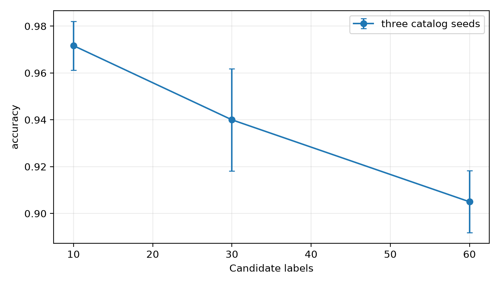
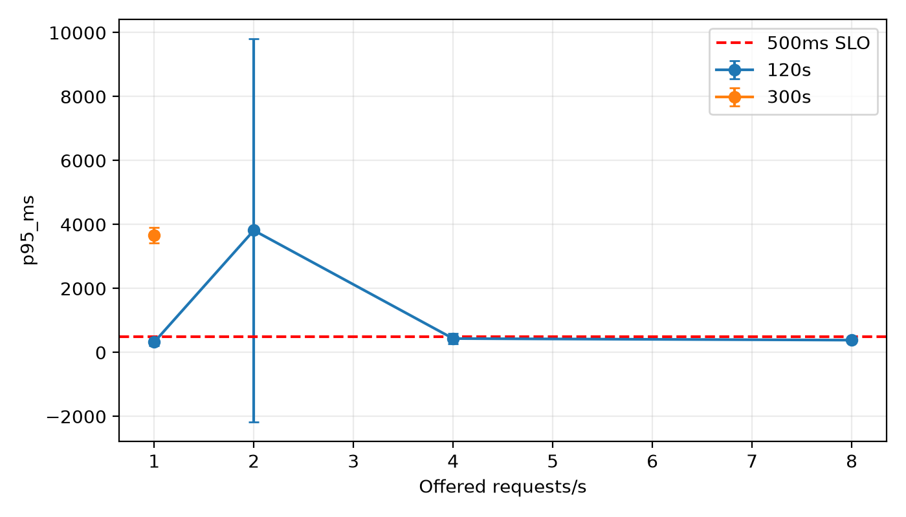

# 本地 Jev v4 实验报告

定稿日期：2026-10-15。实验实际跨越 2026-10-14/15；文档文件名保留启动日期。请求于 2026-10-15 05:29:54 UTC（北京时间 13:29:54）全部结束。本报告包含两份冻结计划、去重后的 27 个完成 run；历史中断、预检和探针另列费用，不拼接为完成轮次。

## 结果与适用范围

在 MASSIVE en-US 完整 test 的同一组 2974 个唯一样本上，Jev-1.13.0 三轮平均 Accuracy 为 **86.12418740%**，轮间样本标准差 **0.06999549 个百分点**。三轮重复调用不能当作 8922 个独立样本。与已封存 Qwen v4 的逐轮配对准确率差为 +40.1143 / +40.2152 / +40.2488 个百分点，输入与目录语义一致性、区间和部署差异见 [配对比较](QWEN_JEV_COMPARISON_20261015.md)。

固定判据下，本机 Controller—代理—API 路径**没有已确认技术容量**，`confirmed_capacity_rps=null`。1/2/4/8 RPS、120 秒各三轮均不通过；随后按既定最低负载确认策略执行 1 RPS、300 秒三轮，900 条测量请求最终全部成功，但三轮 p95 为 3384–3827 ms、最大调度迟滞为 24.745–26.962 ms，均不通过。该结论描述本次端到端部署条件，不能解释成 API 服务或模型硬件的吞吐硬上限。

当前完成 v4 的已知测量费用为 **1.328246850 USD 下界**，加预热为 **1.337850696 USD 下界**；全部本地已记录 Jev 历史运行、预热和探针合计 **2.049680304 USD 下界**。失败尝试可能计费但 usage 未知，本报告没有供应商账单，也没有换算汇率。

## 数据、目录与执行方法

真值来自数据集原有 intent 标签，未从模型输出构造。主测试 2974 条、完整目录 60 类，test 真值支持 59 类，`cooking_query` 无 test 真值。目录说明为 AI 审阅，非人工评审；没有根据 test 结果修改真值或说明。报告同时保留 full60 Macro-F1（零除记 0）和 supported59 Macro-F1，后者不替代前者。

数据来源为 Amazon 发布的 MASSIVE 1.1，en-US，使用原生 train/dev/test 分区，许可 CC BY 4.0；[发布者原始包](https://amazon-massive-nlu-dataset.s3.amazonaws.com/amazon-massive-dataset-1.1.tar.gz)。来源清单保存在 `data/normalized/massive-ai-v1/provenance.json`，归一化脚本为 `scripts/prepare_datasets.py`；目录说明作者/审阅者均为 AI，不因此把数据集真值改称人工复审。

首轮审阅发现本机未保留发布者原包。05:50 UTC 从上述官方地址补回 40251390 字节，SHA256 `4cba5faa11c71437928e17cb1b9b3d8b8e727e7ea363a3a9a8045e19c0491577` 与实验前来源清单完全一致；随后从原包重新读取 en-US 原生分区，train11514、validation2033、test2974 及 seed42 checkpoint300 的有序 ID/文本/intent 全部与归一化数据一致，五项归一化文件哈希也通过。没有改动原始实验输入或 GT。验证脚本及结果为 `reports/jev-v4-final-20261015/publisher-source-verification.py/json`；本实验使用自定义单标签指标，不冒称调用了官方 benchmark evaluator。

Jev-1.13.0 通过本机 Windows Controller，经 `127.0.0.1:7897` 代理访问 Typesafe API；HTTP/HTTPS/ALL_PROXY 使用相同路径，NO_PROXY 保留本机。保持原始数据、目录提示、30 秒请求总期限和最大并发 32。供应商服务端硬件、批处理、版本内部实现及同期负载未受本实验控制。

网络策略按用户授权：首次请求后最多追加 3 次，共最多 4 次；仅 `httpx.RequestError` / 传输超时重试，退避 0.5/1/2 秒。原 30 秒总 deadline 不重置，因此未必有时间发足 4 次；保留原 scheduled arrival 与同一并发槽位，重试及退避计入端到端延迟。HTTP、adapter、invalid 最终错误不按网络策略重试。恢复后的逻辑成功继续运行；最终传输耗尽或上述最终错误停止后续阶段，不自动重新整轮。

500 ms p95、成功率至少 .99、最大调度迟滞 20 ms 为仓库既有技术判据；精确自适应扩展、三轮逐点确认与每个 60 秒窗口全部通过是后来补充的实验方法。没有用户提供的业务语义准确率下限，技术合法性/时延 SLO 与语义准确率分别报告。

冻结计划：

| 计划 | 实际执行范围 | plan.json SHA256 |
| --- | --- | --- |
| `experiments/massive-jev-local-v4-retry3` | main3、scale9、pilot load12 | `e4af0d581f9306b49f0d1f72e8b84404510dfb44e905def4b6803bf756fdf267` |
| `experiments/massive-jev-local-v4-retry3-formal` | 复用 main3，新增 1 RPS × 300 秒 × 3 | `badc58959d3119553ec1fc55e217b985c61433b9a18dab3f19203f05e30ff955` |

派生计划仅引用已完成 main 的原始输入与完成证据，没有再次发送 main。两个计划按 run 目录去重后为 27 个完成 run、17022 条测量和 135 条预热。`reports/jev-v4-final-20261015/audit.json` 记录逐 run 请求哈希、源快照校验和独立质量复算；冻结核心未在这些后续工具工作中修改。所有 run 保留自身 `source/` 快照，不能用新源码重写旧哈希绕过校验。

## 主质量三轮

| 种子 / 轮次 | 测量逻辑 ok | Accuracy | full60 Macro-F1 | supported59 Macro-F1 | p95 ms | 追加 / 恢复请求 |
| --- | ---: | ---: | ---: | ---: | ---: | ---: |
| 42 / 1 | 2974 | 86.04572966% | .8370084067 | .8511949898 | 279.996 | 5 / 2 |
| 43 / 2 | 2974 | 86.14660390% | .8392506082 | .8534751948 | 332.718 | 4 / 3 |
| 44 / 3 | 2974 | 86.18022865% | .8393599458 | .8535863855 | 257.970 | 3 / 1 |

8922 条逻辑测量均最终 ok，实际 8934 次适配器尝试，含 12 次追加、6 条恢复请求。成功恢复不表示网络无失败，也不保证失败尝试免费。已知测量费用 0.725250204 USD 下界，15 条预热另计。

按 sample_id 配对，1–2、1–3、2–3 轮分别有 33、36、29 条预测不同；48 个唯一样本至少一轮预测不同。不能声称 Jev 确定性复现。详见 `repeat-disagreements.csv`，每轮 per-class 与 confusion CSV 保留全部类别。

## 目录规模配对实验

| 目录类别数 | seed42 Accuracy | seed43 | seed44 | 均值 |
| --- | ---: | ---: | ---: | ---: |
| 10 | 98.0% | 96.0% | 97.5% | 97.16666667% |
| 30 | 93.0% | 92.5% | 96.5% | 94.0% |
| 60 | 89.5% | 90.0% | 92.0% | 90.5% |

每个种子使用固定 10 个 anchor 真值类、每类 20 条，共 200 条；同种子 10/30/60 类目录嵌套增加干扰类，样本不变。它衡量固定 anchor 子集上的目录扩展影响，不能称为完整 60 类 test，也不能把目录重复测量当新增独立样本。九组 1800 条测量全 ok，无追加尝试；已知费用 0.091138572 USD，45 条预热另计。

种子内按相同 sample_id 配对，2000 次 bootstrap、随机种子 42。60 类减 10 类准确率差的 95% 区间：seed42 −8.5 个百分点 [−12.5, −5.0]；seed43 −6.0 [−9.5, −3.0]；seed44 −5.5 [−9.0, −2.5]。全部九组比较见 `scale-paired-comparisons.csv`；区间仅描述本次样本与目录，不能推广为所有目录的规律。

## 负载初测与正式容量确认

下表各列表按 seed42/43/44 排列；每点三轮 120 秒。

| offered RPS | p95 ms（三轮） | 最大调度迟滞 ms（三轮） | 整轮通过数 |
| --- | --- | --- | ---: |
| 1 | 256.210 / 249.366 / 456.526 | 28.080 / 24.568 / 24.733 | 0/3 |
| 2 | 255.787 / 10740.229 / 451.413 | 95.432 / 41.609 / 27.734 | 0/3 |
| 4 | 502.560 / 542.929 / 255.092 | 25.285 / 134.539 / 27.258 | 0/3 |
| 8 | 442.142 / 374.734 / 337.582 | 68.293 / 29.553 / 26.489 | 0/3 |

Pilot load 共 5400 条测量，5397 ok，3 `client_overload`（8 RPS seed42），87 次追加恢复 71 条请求。client_overload 是 Controller 未送入适配器的请求，不能归类为 API 网络错误或 API 硬容量。没有最终 HTTP/传输耗尽；全部 24 个 60 秒窗口未通过。已知测量费用 0.438698358 USD 下界，60 条预热另计。

无 pilot 通过点后，既定策略确认最低已测 offered rate，新增 1 RPS、300 秒三轮：

| 种子 | 最终 ok | p95 ms | 最大迟滞 ms | 适配器尝试 / 追加 / 恢复 | 60秒窗口通过 |
| --- | ---: | ---: | ---: | ---: | ---: |
| 42 | 300 | 3827.211750 | 26.104700 | 327 / 27 / 14 | 0/5 |
| 43 | 300 | 3795.938760 | 26.962300 | 325 / 25 / 13 | 0/5 |
| 44 | 300 | 3384.419375 | 24.744600 | 326 / 26 / 14 | 0/5 |

正式 900 条测量全 ok、978 次实际尝试、78 次追加、41 条恢复，已知测量费用 0.073159716 USD 下界；15 条预热另计。三轮均不通过，15 个窗口均不通过。容量状态文件 `results/execution-20261014/jev-local-v4-retry3-capacity-status.json` 已 `completed`，未确认容量。全部 pilot+formal 共 39 个窗口，0 个通过。禁止将请求最终成功率 100% 替代 500 ms/.99/20 ms 联合判据。

配额按实际尝试和输入+输出 Token 含重试筛查。供应商公布动态 80 RPS / 100000 Token/s 并非账号保证。三轮 main 观测每次最大 2563 Token，四倍尝试预算下 8 RPS 为 32 attempt/s、82016 Token/s；16 RPS 为 64 attempt/s、164032 Token/s。8 RPS 未通过，未进入扩展；16 RPS 没有实测，不把预算筛查当实测失败。该估计不是精确 tokenization、突发限速或账号配额保证。输出价格 0 仍计入 Token 吞吐。

本机 Controller 曾与离线审计、bootstrap 和工具测试同时运行，可能争用 CPU/IO；没有资源时序证据可将具体 lag 归因于某项后台任务。正式 300 秒三轮期间暂停了计算密集型分析、测试、绘图及压缩，仅轻量状态/日志工作；仍未通过。保留全部原始 lag，不降低门槛，也不声称测得 API 纯服务容量。

## 重试、费用及历史账

价格按官方标准输入 0.042 USD/百万 Token、输出 0（2026-10-14 配置，来源 https://docs.typesafe.ai/models）。使用已记录的真实 usage 计价，失败尝试未知 usage 无法补算，不伪造账单。

| 当前完成 v4 范围 | 逻辑请求 | 实际适配器尝试 | 追加 / 传输失败 | 恢复逻辑请求 | 已知 USD |
| --- | ---: | ---: | ---: | ---: | ---: |
| 测量 | 17022 | 17196 | 177 / 177 | 118 | 1.328246850 |
| 预热 | 135 | 138 | 3 / 3 | 2 | .009603846 |
| 合计 | 17157 | 17334 | 180 / 180 | 120 | 1.337850696 |

测量最终 17019 ok、3 client_overload；预热 135 条全 ok。17196 = 17022 − 3（未调用适配器）+ 177。含任何未知失败 usage 的成本为下界，即使逻辑请求恢复成功也一样。64968 等预算数字是最大尝试预算，不是实际花费或已发送次数。

| 历史账范围 | 已知 USD 下界 |
| --- | ---: |
| 当前完成 v4 测量+预热 | 1.337850696 |
| 其他历史/中断/预检测量 | .706590444 |
| 其他历史预热 | .005124924 |
| 所有 run 小计 | 2.049566064 |
| 8 次已记录成功合成 POST 探针 | .000114240 |
| 全部已知日志合计 | **2.049680304** |

历史另有 8710 条测量、65 条预热，分别 18、2 条最终非 ok；早期无逐次 retry 字段的 attempt 只能按其冻结策略/记录推断，账表明确区分。一个本地 v2 探针在 GET 阶段 ConnectTimeout，记录 `evaluation_requests=0`、`steps=[]`，未发送推理 POST；保留其失败证据，不捏造推理 usage。探针用于连通性，不进入质量指标。费用账覆盖所有实际 Jev manifest，包括早期远程/本地预检，范围比本报告 27 个完成 run 更广。

旧 v1/v2/v3 和 v4 中断全部保留。v3 的 300 条 checkpoint、Accuracy 87.6667% 为无重试历史预检，不冒充 v4 质量。旧 v4 main2 241 条中 1 条传输最终耗尽，resume1 main2 24 条中 1 条 HTTP499，均保持中断并独立计价；用户新授权后 resume2 从完整轮次重跑，未拼接成完整轮次。已完成 main1 没有重发。HTTP499 恢复开关只允许审阅后的中断整轮恢复，不扩大 HTTP 单请求重试范围。

## 错误案例与完整性审阅

[40 条 AI 错误审阅](JEV_ERROR_REVIEW_20261014.md)来自第一轮 415 条语义错误：前 20 个混淆方向各取一例，再以 seed42 补足 40 条。保留 sample_id、原文、GT、预测和说明。它是 AI 定性审阅，非人工标注；歧义或上下文缺失只是待人工核实的假设，不修改 GT、不调整得分，不将选样比例当作总体错误分布。

确定性检查包括完成证据、冻结输入/源码哈希、逐 run 源快照、独立质量复算、三轮配对输入、重试统计与费用分账。另使用 `experiment-audit` 技能进行新鲜审阅代理检查；同系列模型的语义审阅只能标注 `review_independence=same-family`、`acceptance_status=provisional`，详见根目录 `EXPERIMENT_AUDIT.md/json`。它不替代人工评价或跨模型家族审计。

## 可复算证据与交付物

- `reports/jev-v4-final-20261015/`：实际已运行报告器生成的 runs/groups、逐类指标、混淆、规模配对区间、重复差异、39 个窗口、图表、retry 与费用账；不以代码存在冒充执行。
- `reports/qwen-jev-main-paired-20261015/`：双方有序输入/目录检查、每轮 2974 条配对、2000 次 bootstrap。
- `results/execution-20261014/`：各阶段状态、运行日志、完成审计与启动/失败回执。
- `docs/EXECUTION_LOG_20261014.md`、`refine-logs/EXPERIMENT_TRACKER.md`：时间线、授权变更、归档 SHA256 与阶段状态。
- `dist/jev-v4-final-evidence-snapshot.tar.gz` 与其 receipt：原始/冻结/历史证据的最终快照，逐成员 SHA256 校验。
- `dist/jev-v4-source-provenance-snapshot.tar.gz` 与其 receipt：补齐发布者原包、归一化数据、准备脚本和原生分区比对；12 成员逐哈希校验，SHA256 `9d81c77571c671b74212fd035d592c1c9881974c39088940f41f3d8fd15d7ca7`。
- `dist/jev-v4-final-deliverables-snapshot.tar.gz` 与其 receipt：报告、离线结果、工具、审阅轨迹与确定性校验回执；哈希见执行日志及交付回执。

复算入口（仅离线，不再调用 API）：`python -m orchestration.jev_report --plan experiments/massive-jev-local-v4-retry3/plan.json --plan experiments/massive-jev-local-v4-retry3-formal/plan.json --out <新的唯一目录>`，随后 `python -m orchestration.jev_cost_ledger --report <同一目录>`。输出目录不可覆盖。Qwen 原 40 run、报告和封存归档保持原状，Worker 不重启。

原始证据归档 SHA256：`511a7401a752ea06483997c9efad93e0b36adf684a86a26c46f9c9443f5bb91d`；2141 个成员均完成源文件/归档流哈希校验。最终交付物归档的自身哈希记录在独立 `.tar.receipt.json`，避免归档文件自引用。
