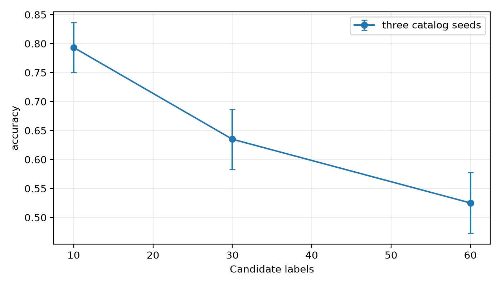
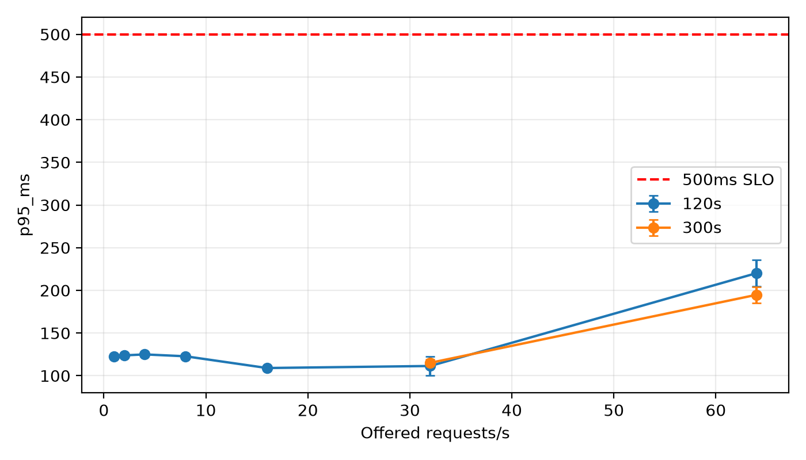
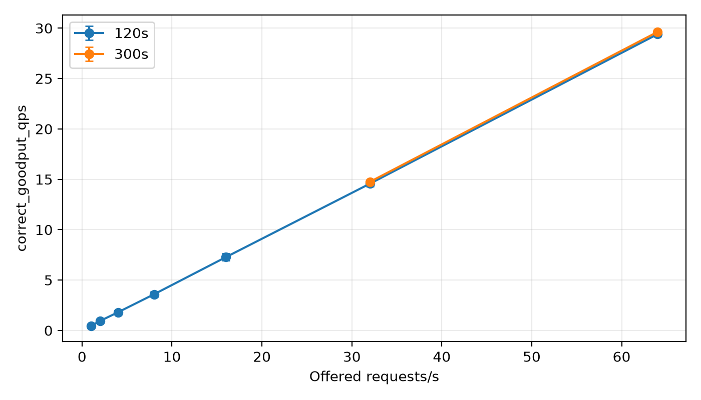

# Qwen3-0.6B 实验报告（2026-10-14）

本报告只覆盖用户授权的 Qwen 实验。全部真实模型测试于北京时间 **20:48:15** 完成，最终离线审计通过，共 **40 个独立完成运行、143,142 个测量请求及 2,000 个预热请求**。Jev 按用户要求保持暂停，旧 checkpoint 和中断的主测试不进入本报告的模型对比。

完整 60 类测试的准确率为 **45.93%**，三次重复预测完全一致。固定 JSON Schema 枚举约束使所有已发出并返回的 v4 模型预测均为合法标签，但不能据此认定语义质量满足业务要求。技术容量方面，**32 RPS 是已测试的最高稳定通过点**：三轮 300 秒及全部 15 个 60 秒窗口均通过；64 RPS 的三轮中两轮因 Controller 调度迟滞超过 20ms 未通过。此结论针对本次完整调用链，不能解释为 RTX 5090 或模型本身的绝对吞吐极限。

## 1. 任务、数据和实验范围

任务为 MASSIVE 1.1 en-US 的单标签意图分类，模型从冻结目录选择一个标签。没有微调。数据划分为 train 11,514、dev 2,033、test 2,974；checkpoint 为 dev 中冻结的 300 条。目录有 60 类，类别说明基于训练样例整理并由 **AI 审阅，非人工审阅**。没有使用测试错误修改说明、提示词或真值。

完整 test 的真值实际支持 59 类，`cooking_query` 没有 test 真值。它仍保留在候选目录和完整目录 Macro-F1 中；另列仅对 59 个有真值支持类别计算的 supported Macro-F1，避免两种口径混用。

类别说明版本为 `massive-ai-reviewed-v1-c243b3879e39`，数据在 `data/normalized/massive-ai-v1` 冻结。以下所有主表均使用 v4 固定 guidance 后端。旧版本仅用于方法变更追溯。

## 2. 模型、环境与测量方法

| 项目 | 实际设置 |
|---|---|
| 模型 | Qwen/Qwen3-0.6B，BF16 |
| 权重标识 | `modelscope-manifest-sha256:f7cb819c0cbceca9170480b859dc0a593a11db4e976fba9104884828a020f993` |
| GPU | NVIDIA GeForce RTX 5090，32607 MiB |
| 软件 | Torch 2.8 + CUDA 12.8，vLLM 0.11.0，transformers 4.57.6 |
| 解码 | temperature=0，关闭 thinking，最多输出 64 Token |
| 结构化输出 | 当前目录标签的 JSON Schema enum；固定 guidance；禁止自动回退 |
| Worker | max_model_len=4096，max_num_seqs=32，GPU memory utilization=0.9，关闭 prefix cache |
| Controller | 与 Worker 同一服务器，通过 loopback 调用；最大并发32，超时30s |
| 预热和间隔 | 每个运行50条预热，运行间冷却30s；预热独立记录，不进入主指标 |
| 价格 | 用户提供，2.78 CNY/小时 |

质量测试每轮顺序处理完整 test，三轮用于检查重复稳定性，不视为 8,922 个独立样本。规模实验按种子 42/43/44 选择 anchor 类与共同样本，每个种子三个规模共享 200 条输入，候选目录按 10/30/60 类嵌套；不同种子的样本不能假定互不重叠。它衡量增加干扰类别的影响，60 类规模子集的结果也不能替代完整 test 主结果。

负载实验采用预定到达速率；每个种子内打乱负载点顺序。先对1/2/4/8 RPS各测120秒三轮，通过后扩展16/32，再按翻倍规则测试64。64首次未通过后停止上探，将最高通过点32及最近更高失败点64各做300秒三轮。未测试32与64之间的更细负载点。

冻结的技术通过条件为：合法成功率≥99%、已尝试请求的端到端p95≤500ms、Controller最大调度迟滞≤20ms。正式容量还要求三次运行和每个60秒窗口全部通过。成功表示合法完成分类；correct goodput另要求预测与真值相符，并满足SLO。测量耗时含结束后的drain；预热、冷却、准备和空闲不进入该测量耗时。

## 3. 实际完成的实验数量

| 部分 | 独立运行数 | 测量请求数 | 用途 |
|---|---:|---:|---|
| checkpoint | 1 | 300 | 目录和输出合法性检查 |
| 完整test主质量 | 3 | 8,922 | 同一2,974个样本的三次重复 |
| 目录规模 | 9 | 1,800 | 3种子×10/30/60类×200条 |
| 120秒负载 | 21 | 45,720 | 1/2/4/8/16/32/64 RPS各三轮 |
| 300秒正式负载 | 6 | 86,400 | 32/64 RPS各三轮 |
| 合计 | **40** | **143,142** | 另有2,000条预热 |

派生计划引用相同的三轮主质量基线。审计按 `run_dir` 去重，没有将引用当作新增运行、样本或费用。143,142条是测量计划记录数，其中3条为Controller `client_overload`，没有发给模型；因此不能把它全部表述为成功模型调用。共143,139条测量记录状态为ok，整体合法成功率约99.9979%。

## 4. 主质量结果与重复稳定性

| 运行 | 样本数 | Accuracy | Macro-F1（60类） | Supported Macro-F1（59类） | 合法成功率 | p95/ms |
|---|---:|---:|---:|---:|---:|---:|
| 第1轮 | 2,974 | 45.9314% | 0.487239 | 0.495498 | 100% | 120.679 |
| 第2轮 | 2,974 | 45.9314% | 0.487239 | 0.495498 | 100% | 122.006 |
| 第3轮 | 2,974 | 45.9314% | 0.487239 | 0.495498 | 100% | 121.269 |

三轮全部2,974个样本的状态与预测标签一致，重复差异数为0。以单轮2,974个样本计算Accuracy的95% Wilson区间为 **44.15%–47.73%**；不会把三轮重复合并成更大的独立样本量来缩窄区间。主质量平均输入约1,247.37 Token、平均输出约8.55 Token。

300条checkpoint准确率53.33%，完整目录Macro-F1=0.512616，supported Macro-F1=0.521304，合法成功率100%。checkpoint与完整test使用不同数据，不能用checkpoint较高的准确率替代主表。

40个代表错误的逐例AI审阅见 [错误审阅记录](QWEN_ERROR_REVIEW_20261014.md)。抽样为首轮最高频20个混淆对各一条，再以seed42抽取20条剩余错误；它不是总体错误类型占比的无偏估计。常见问题包括播放动作与信息查询混淆、邮件查询与联系人查询混淆、日历与日期时间混淆，以及把多种非问候输入预测为`general_greet`。少数短文本缺少设备或对话上下文，审阅保留原始真值，不进行事后标签修正。

## 5. 候选类别规模

| 种子 | 10类Accuracy | 30类Accuracy | 60类Accuracy |
|---|---:|---:|---:|
| 42 | 75.5% | 66.0% | 58.5% |
| 43 | 78.5% | 57.5% | 50.5% |
| 44 | 84.0% | 67.0% | 48.5% |
| 均值 | **79.33%** | **63.50%** | **52.50%** |
| 跨种子样本标准差 | 4.31个百分点 | 5.22个百分点 | 5.29个百分点 |

全部1,800条输出合法。平均p95分别112.65/113.29/115.92ms；本设置下质量随类别增加明显下降，而延迟增加较小。种子内配对bootstrap（2,000次，固定seed42）的60类减10类Accuracy差及95%区间如下，单位为百分点：

| 种子 | 差值 | 95%配对区间 |
|---|---:|---:|
| 42 | −17.0 | [−23.5, −11.0] |
| 43 | −28.0 | [−35.5, −20.0] |
| 44 | −35.5 | [−42.5, −29.0] |

这些区间是各固定anchor子集内的样本重采样区间，未覆盖全部任务、所有类别目录选择和训练不确定性，不代表跨数据集的普适效应。

## 6. 负载与正式技术容量

120秒初测每点三轮，表中为三轮最差值：

| RPS | 最大p95/ms | 最低合法成功率 | 最大调度迟滞/ms | 三轮均通过 |
|---:|---:|---:|---:|---|
| 1 | 122.750 | 100% | 2.622 | 是 |
| 2 | 123.915 | 100% | 2.778 | 是 |
| 4 | 126.365 | 100% | 2.695 | 是 |
| 8 | 123.181 | 100% | 6.140 | 是 |
| 16 | 109.024 | 100% | 2.819 | 是 |
| 32 | 118.405 | 100% | 17.263 | 是 |
| 64 | 234.512 | 99.98698% | 21.745 | 否 |

正式300秒复测：

| RPS/重复 | p95/ms | 合法成功率 | 最大调度迟滞/ms | 全窗口及60s窗口均通过 |
|---|---:|---:|---:|---|
| 32/1 | 116.508 | 100% | 5.777 | 是 |
| 32/2 | 110.608 | 100% | 5.193 | 是 |
| 32/3 | 118.017 | 100% | 12.855 | 是 |
| 64/1 | 205.585 | 99.98958% | 35.737 | 否 |
| 64/2 | 188.865 | 100% | 33.422 | 否 |
| 64/3 | 189.865 | 100% | 15.343 | 是 |

**32 RPS通过三轮全部15个60秒窗口，是本次确认的最高已测试稳定通过点。** 平均SLO合法goodput为31.9969次/秒，平均语义正确goodput为14.7441次/秒；负载采样Accuracy均值46.08%，与完整test的45.93%口径不同。64 RPS的p95和合法成功率满足门槛，但前两轮的调度迟滞及相应窗口失败，不能以第三轮通过覆盖前两轮失败。

64 RPS的失败反映当前Controller、并发上限、同机调度和模型服务组成的调用链未稳定满足20ms调度限制。共3条`client_overload`：120秒第二轮1条，300秒第一轮2条；其余测量请求均为ok。没有在实验中修改并发、调度阈值或Worker以追求通过。32–64 RPS之间未细扫，128/256未测试，不能声称精确极限就是32 RPS，也不能将64的延迟达标解释为已确认稳定容量。

## 7. 费用与使用情景

按2.78 CNY/小时，40个独立运行的测量区间（含drain）合计 **5,451.286秒，约1.5142小时，对应4.209604 CNY**。这只计算v4本报告的测量时间，排除预热、冷却、下载、诊断、准备、旧版本重跑和空闲；不能表述为服务器实际总账单。

32 RPS正式复测下，按持续利用对应的测量费用，平均每百万合法成功请求约 **24.13 CNY**；按真值正确分类计，每百万正确请求约 **52.38 CNY**。这是当前采样质量和满负载利用假设下的摊销，低利用率、预热、运维或持续租赁空闲会提高单位费用。64 RPS未稳定通过，不将其更低的单位费用作为推荐部署报价。

从本次恢复Qwen实验的约18:28至20:48:15测试结束，按连续租赁估算约 **6.50 CNY**；至20:54:33停止Worker，约 **6.79 CNY**。起点仅为本次续跑近似时间，不是实例租赁起始时间；实例可能早已计费、之后也可能继续计费，实际费用须以平台账单为准。**停止Worker不会停止实例计费。** 若连续租赁30天、每天24小时且价格不变，仅实例费用为2,001.60 CNY；这不是业务月度总成本承诺。

## 8. 方法变更、异常与修复记录

1. 旧v1无枚举约束的checkpoint曾产生6条目录外标签。用户批准增加枚举约束并以新版本重跑，旧结果保留。
2. 旧v3的完整60类JSON Schema在vLLM `auto` 后端下实际出现目录外标签`datetime_settings`；独立诊断能够复现完整目录违约，而单标签约束可通过。证据不足以定位xgrammar内部缺陷。v3首轮及第二轮部分结果保留，不纳入当前主表。
3. v4改用固定guidance、禁止回退。完整目录与强制枚举诊断通过后，从checkpoint开始重新跑全套。模型权重、数据、提示词、输出预算等未据测试错误修改。当前全部完成测量中没有目录外预测。
4. pilot完成后，容量派生计划准备遇到Windows CRLF与Linux LF输入字节差异，原严格哈希检查在发送扩展请求前阻止执行。修复要求新旧文件除该换行差异外逐字节相同，再把基线原始字节复制至尚未执行的新计划，重算并严格核对哈希。失败准备目录、状态和日志保留，采用`retry1`新目录，不改原始冻结计划。
5. 修复及工具本地56项测试通过，远程相关21项通过；1条上游FastAPI/Starlette弃用警告不影响结果。最终审计复核输入、配置、源代码快照、结果哈希并独立复算指标，去重引用基线。服务器存在早期Windows/Linux行尾导致的源工作区差异，manifest如实记录git dirty；实际运行源字节均被冻结并核验，不将服务器描述为干净检出。

## 9. 可复查材料、备份与限制

最终派生配置已存入Git：`configs/massive-qwen-guidance-extended16-32-v4-retry1.yaml`、`configs/massive-qwen-guidance-extended64-v4-retry1.yaml`、`configs/massive-qwen-guidance-formal-v4-retry1.yaml`；主配置为`configs/experiment-suite-qwen-v4.yaml`。冻结计划、原始运行和报告生成物单独归档。

| 冻结计划目录 | plan.json SHA-256 |
|---|---|
| massive-qwen-guidance-pilot-v4 | `2c0c9d8031c60135ae7c700a1ad90604e84528c3a7d6be70bd471e66b9dc0f19` |
| massive-qwen-guidance-extended16-32-v4-retry1 | `273a0bc262e11c68ee5a02b2c1364254238b697ec45ac5c69a96a7894ffa62c3` |
| massive-qwen-guidance-extended64-v4-retry1 | `bda0dedada6d5c6e2e55e20ed854b38a3516147f97a875d9e34d9e0083caa520` |
| massive-qwen-guidance-formal-v4-retry1 | `30d4c2128d5c13588abc43f72fe11fe87ac184637b05ef12315002b1ab98297b` |

全部40个独立运行的归档为 `dist/qwen-v4-final-capacity-snapshot.tar.gz`，SHA-256 **`a799169fce4f501f20924283236def65ab6200085027f0d16e584a5cb75e47d0`**；本地下载后与远程哈希一致。执行控制器均已结束，拥有的Worker19643已正常停止并保存停止回执，未关闭服务器实例或用户SSH转发。

完整证据位于 [最终审计JSON](../reports/qwen-v4-final-20261014/audit.json)、[逐运行指标](../reports/qwen-v4-final-20261014/runs.csv)、[分组统计](../reports/qwen-v4-final-20261014/groups.csv)、[60秒窗口](../reports/qwen-v4-final-20261014/steady-60s-windows.csv)、[规模配对区间](../reports/qwen-v4-final-20261014/scale-paired-comparisons.csv)、[失败请求](../reports/qwen-v4-final-20261014/failures.csv)；目录还包含逐类F1、混淆矩阵及40条选定错误。方法和异常完整日志见 [执行日志](EXECUTION_LOG_20261014.md)。

限制包括：单一英语数据集、单一0.6B权重、单台GPU、固定提示词和AI审阅目录；仅三次短期重复，不能推断数天连续稳定；同机loopback时延不代表公网或实际终端；没有业务语义精度门槛，技术容量通过不等于业务可用。Jev完整实验没有执行，旧checkpoint不足以作最终主对比；类别说明消融属于原计划可选项，本轮未启用。后续若需要提升约46%的语义准确率，应建立新的开发实验版本，用dev集比较提示词、说明或微调方案，再使用独立冻结test进行确认，不能覆盖本轮结果。
