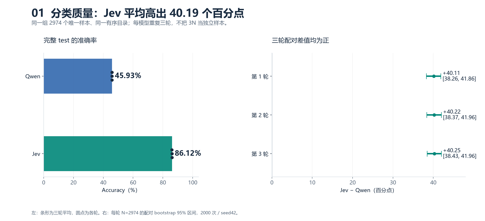
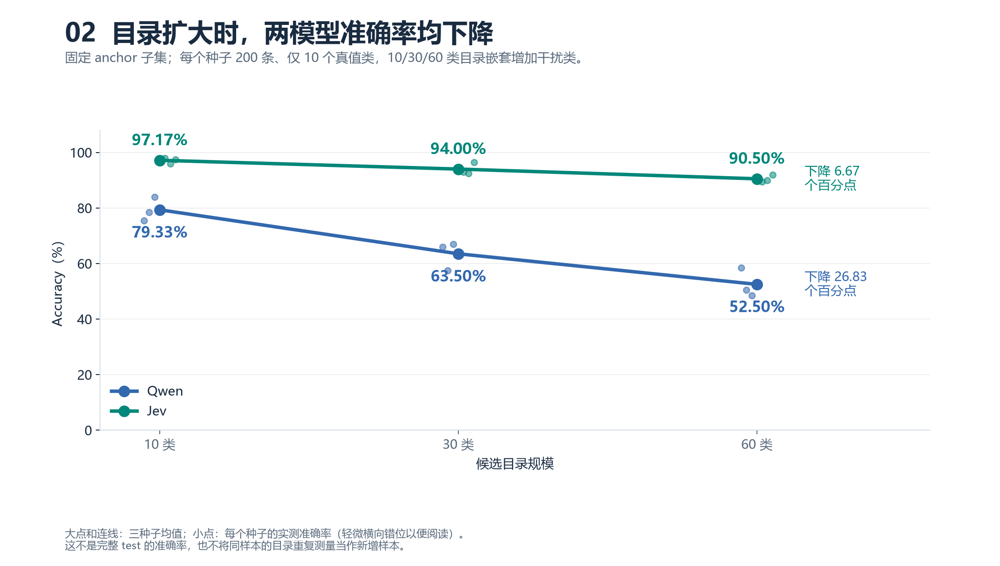
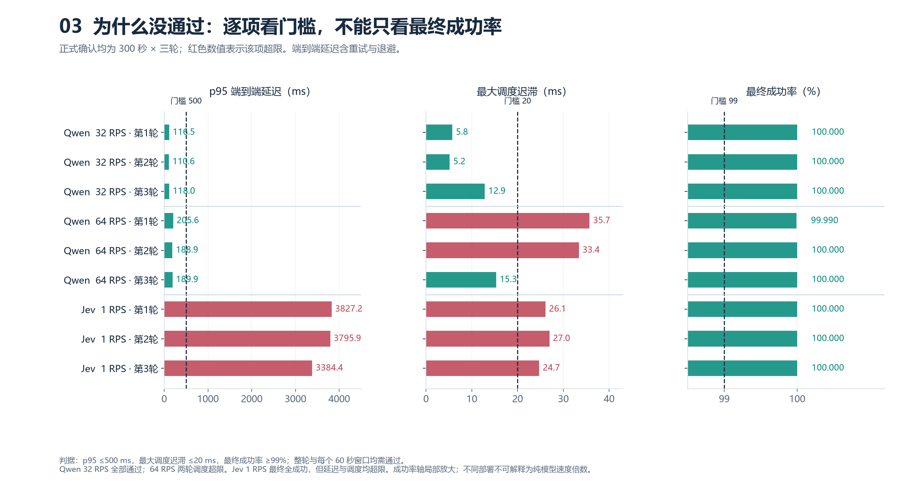

# Qwen v4 与本地 Jev v4 的配对比较

更新日期：2026-10-15。双方主质量、负载、正式容量和费用分析均已完成。Jev 请求于 05:29:54 UTC 结束，原始证据和最终报告已保存；Qwen 保持原封存版本。本比较不使用早期 checkpoint 代替完整 test。

Qwen 封存报告内“Jev 尚未完成”的文字描述其 2026-10-14 截止时点，作为历史文档保留；Jev 最新状态以本比较和 Jev 最终报告为准。

## 结果图解

图中红色仅表示该项超限，绿色仅表示该项达标；最终成功率不等于分类准确率。全部图解、逐分钟窗口、判据说明和SVG导出见[实验图解报告](VISUAL_EXPERIMENT_RESULTS_20261015.md)。图由原封存CSV绘制，不改变测量值或判据。

## 已完成的主质量结果

双方都使用 MASSIVE en-US 完整 test 的同一组 **2974 个唯一样本**。每个模型重复三轮，三次调用不构成 8922 个独立样本。离线检查逐项比较了输入的 sample_id、原始文本、数据集真值与顺序，以及完整目录的版本、标签顺序和说明；语义输入完全一致。Windows/Linux 文件换行字节可不同，原始文件及各自哈希保留。

| 主实验轮次 | Qwen Accuracy | Jev Accuracy | Jev−Qwen 准确率差（百分点） | 配对 bootstrap 95% 区间（百分点） |
| --- | ---: | ---: | ---: | ---: |
| 1 | 45.9314% | 86.0457% | +40.1143 | [+38.2650, +41.8628] |
| 2 | 45.9314% | 86.1466% | +40.2152 | [+38.3658, +41.9637] |
| 3 | 45.9314% | 86.1802% | +40.2488 | [+38.4331, +41.9637] |

每轮区间以配对唯一样本为抽样单位，2000 次有放回抽样、随机种子 42；没有将三轮数据拼接后当作独立样本抽样。区间描述固定数据集/目录和本次模型行为下的样本不确定性，不覆盖更换任务、目录或模型版本带来的变化。

| 模型 | 三轮平均 Accuracy | 完整 60 类目录 Macro-F1（各轮） | 有 test 真值的 59 类 Macro-F1（各轮） |
| --- | ---: | --- | --- |
| Qwen3-0.6B BF16 / 固定 guidance | 45.9314% | 0.487239 / 0.487239 / 0.487239 | 0.495498 / 0.495498 / 0.495498 |
| Jev-1.13.0 / 本地 API / 网络重试 3 次 | 86.1242% | 0.837008 / 0.839251 / 0.839360 | 0.851195 / 0.853475 / 0.853586 |

完整目录有 60 类，test 仅支持其中 59 类；`cooking_query` 没有 test 真值。完整目录 Macro-F1 采用零除记 0，因此同时报告 supported-F1，不能隐去零支持类别或将 supported-F1 改名为完整目录 F1。目录说明经过 AI 审阅，非人工评审；未依据 test 修改真值或说明。

以第一轮为例，1323 条双方均正确、43 条只有 Qwen 正确、1236 条只有 Jev 正确、372 条双方均错误。对应逐样本结果见 `reports/qwen-jev-main-paired-20261015/paired-sample-outcomes.csv`，后两轮也分别保留。三轮 Qwen 预测一致；Jev 的 1–2 / 1–3 / 2–3 轮分别有 33 / 36 / 29 条预测不同，不将 Jev 描述为确定性复现。

## 候选目录规模

| 候选类别数 | Qwen 三种子平均 Accuracy | Jev 三种子平均 Accuracy |
| --- | ---: | ---: |
| 10 | 79.3333% | 97.1667% |
| 30 | 63.5000% | 94.0000% |
| 60 | 52.5000% | 90.5000% |

每个种子固定 10 个 anchor 真值类、每类 20 条，共 200 条样本；10/30/60 类目录内嵌套增加干扰类，种子内使用相同样本。它衡量本次目录扩展对固定 anchor 子集的影响，不能当作完整 60 类 test 的替代结果，也不能把多个目录重复测量当新增独立样本。Jev 各种子内规模差值的配对 bootstrap 已保存于 `results/execution-20261014/jev-v4-scale-completed-audit.json`，Qwen 对应数据见封存最终报告。

## 部署与解释边界

Qwen 使用远程 RTX 5090 上的 vLLM 0.11.0、Qwen3-0.6B BF16、JSON Schema enum 和固定 guidance 后端；旧 auto 后端方法版本不进入本次 v4 主比较。Jev 使用本机 Windows Controller，经 127.0.0.1:7897 代理调用 Jev-1.13.0 API。供应商模型大小、服务侧批处理、硬件和负载条件不受本实验控制。

Jev v4 按用户授权，对传输异常最多追加 3 次请求，首次加追加最多 4 次，退避 0.5/1/2 秒，总期限仍为原始 30 秒；重试等待计入端到端延迟，并占用原并发槽位。HTTP/非法输出不重试。三轮 main 的 8922 条逻辑请求最终全部成功，但发生 12 次追加尝试、恢复 6 条请求，不能把最终合法 100% 写成原始网络链路无失败，也不能将合法率等同于语义质量。Qwen 和 Jev 的主测试网络与重试条件不同，延迟、吞吐和成本不能解释为仅由模型本身造成的差异。

Qwen 已封存的技术容量点为 32 RPS、300 秒三轮及全部 60 秒窗口通过；64 RPS 两轮因 Controller 调度迟滞超限而不通过，不能解释成 GPU 硬上限。Jev 的 1/2/4/8 RPS、120 秒各三轮均不通过；最低 1 RPS、300 秒三轮最终请求全成功，但 p95 为 3827.212 / 3795.939 / 3384.419 ms、最大调度迟滞 26.105 / 26.962 / 24.745 ms，三轮及全部 15 个窗口不通过，confirmed_capacity_rps=null。没有可用于相除的 Jev 已确认容量，不将其写成容量为 0，也不称为 API 硬上限。

Jev pilot 期间本地离线分析/工具测试与 Controller 同驻，可能争用资源，缺少时序证据不能确定具体因果；正式 300 秒阶段已暂停计算密集型分析、测试及压缩，仍不通过。本比较反映两种不同部署和网络路径的可观测结果，不能隔离模型本身的服务能力。

费用采用各自原币：Qwen 2.78 CNY/h 的测量时段估算，其封存测量费用约 4.209604 CNY；Jev 官方输入 0.042 USD/百万 Token、输出价格 0。三轮 Jev main 已知测量费用 0.725250204 USD；当前 27 个完成 run 测量合计 1.328246850 USD、加预热 1.337850696 USD，全部历史/中断/预检/探针合计 2.049680304 USD，均为已记录 usage 的下界，未知失败 usage 未补算。双方全实验规模与计费口径不同；没有账单或汇率，不制作统一货币的精确价格排名。

## 证据

- `reports/qwen-jev-main-paired-20261015/audit.json`：六个主实验的原始请求/manifest 哈希、独立复算、逐轮配对差值、输入检查和重复预测差异。
- `reports/qwen-jev-main-paired-20261015/paired-comparisons.csv`：逐轮差值与区间。
- `reports/qwen-jev-main-paired-20261015/paired-sample-outcomes.csv`：每轮 2974 条配对记录。
- `docs/QWEN_EXPERIMENT_REPORT_20261014.md`：已封存的 Qwen 方法、40 run、容量、费用与限制。
- `docs/EXECUTION_LOG_20261014.md`：Jev 历史失败、用户授权策略变更、逐阶段审计与备份。

Jev 完整方法、39 个负载窗口、真实重试与历史费用账见 [最终报告](JEV_EXPERIMENT_REPORT_20261014.md)及 `reports/jev-v4-final-20261015/`。主质量优势与当前路径未通过时延/调度 SLO 同时成立。语义完整性审阅由同系列新鲜代理执行，标注为 provisional，见根目录 `EXPERIMENT_AUDIT.md/json`；不能将其称为人工或跨系列独立背书。
