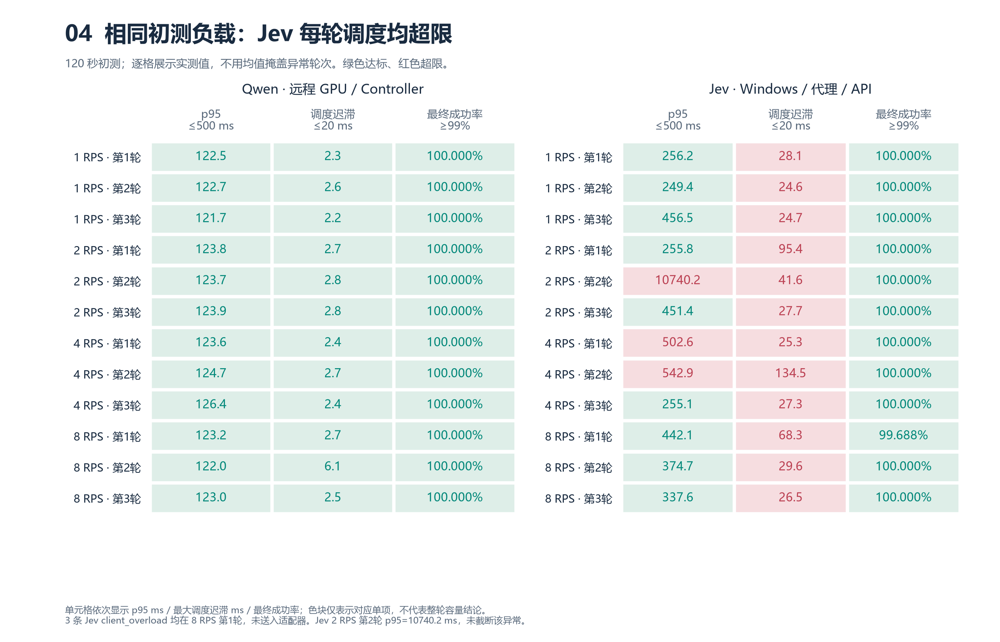
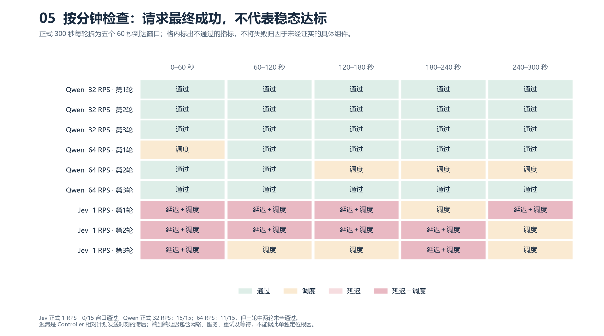

# Qwen 与 Jev 实验图解

更新日期：2026-10-15。以下五组图直接读取已封存的 CSV，没有重跑实验、改动数据或修改判据。每张图提供报告内 PNG 预览和可放大导出的 SVG。

## 1. 分类是否正确：准确率与配对差值

Jev 三轮平均准确率为 **86.12%**，Qwen 为 **45.93%**，相差约 **40.19 个百分点**。左图同时画出各轮，右图给出逐轮配对区间，避免把重复调用当作新增样本。区间表示固定任务下的样本不确定性，不覆盖其他数据集或部署条件。

[下载矢量图 SVG](../reports/experiment-results-20261015/visualizations/01-quality-paired.svg) · 数据：[逐轮配对结果](../reports/qwen-jev-main-paired-20261015/paired-comparisons.csv)。每轮 N=2974；2000次配对 bootstrap，seed42。完整60类与supported59 F1见[主比较报告](QWEN_JEV_COMPARISON_20261015.md)。

## 2. 类别增加后：固定样本上的准确率变化

从10类增加到60类，Qwen 平均准确率下降 **26.83 个百分点**，Jev 下降 **6.67 个百分点**。小点保留三种子的分布，大点和连线表示均值。纵轴从0开始，避免夸大差距。

[下载矢量图 SVG](../reports/experiment-results-20261015/visualizations/02-catalog-scale.svg)。每种子固定200条、10个anchor真值类；嵌套增加目录干扰类。这是子集配对实验，不能与完整test的86.12%直接当作相同口径比较，也不是对所有目录的普遍规律。

## 3. 为什么没通过：把三个判据拆开

三项分别检查，任一项超限都无法确认容量。虚线为门槛，红色为超限，绿色为该单项达标。**成功率表示请求最终完成且输出合法，不表示分类语义正确。**

[下载矢量图 SVG](../reports/experiment-results-20261015/visualizations/03-formal-thresholds.svg)。每个点正式执行300秒、三轮；成功率坐标局部放大，其他两轴从0开始。Qwen 32RPS全部达标；64RPS的第1/2轮只因调度超限未通过。Jev 1RPS最终成功率100%，但三轮延迟、调度均超限。

这张图定位的是**超限指标**，不能单独定位根因。调度迟滞是Controller相对计划发送时刻的滞后；端到端时延包括等待、网络、API处理和重试。双方部署/网络/重试条件不同，不计算纯模型速度倍数；null容量也不能画成0RPS。

## 4. 同样的初测负载：逐轮状态一眼可见

对1/2/4/8RPS各120秒初测，直接展示每轮实测值。Jev所有轮次均调度超限；部分轮次还有时延超限。2RPS第二轮的 **10740.2ms** 异常保留，避免用均值和巨大误差线掩盖具体轮次。

[下载矢量图 SVG](../reports/experiment-results-20261015/visualizations/04-pilot-status-matrix.svg)。Jev 8RPS第1轮最终成功率99.688%，仍高于99%门槛；3条`client_overload`由Controller未送入适配器，不能当作API网络错误。初测有本机后台分析潜在干扰，无时序证据可认定具体因果；正式确认暂停了计算密集型分析，仍未通过。

## 5. 能否保持稳态：每一分钟分别判定

每个格子是一轮中的一个60秒到达窗口。文字直接标出“调度”“延迟”或两者，无需只凭颜色判断。

[下载矢量图 SVG](../reports/experiment-results-20261015/visualizations/05-formal-minute-windows.svg)。Qwen32RPS为15/15通过，64RPS为11/15通过，但三轮中两轮未全部通过，故64RPS不被确认。Jev正式1RPS为0/15通过。加上初测，Jev全部39个窗口均未通过。

## 数据与复用

- [Qwen逐运行指标](../reports/qwen-v4-final-20261014/runs.csv)、[Jev逐运行指标](../reports/jev-v4-final-20261015/runs.csv)：前四组图的运行数据；主差值区间使用已计算的paired-comparisons.csv，不重新拼接3N抽样。
- [Qwen窗口](../reports/qwen-v4-final-20261014/steady-60s-windows.csv)、[Jev窗口](../reports/jev-v4-final-20261015/steady-60s-windows.csv)：第五组图及逐项判据。
- [绘图来源与图文件SHA256](../reports/experiment-results-20261015/visualizations/visualization-manifest.json)：五个源CSV前后哈希一致，图文件单独记录，不覆盖原封存清单。
- 重建命令：`python -m pip install matplotlib numpy
python -m scripts.visualize_experiment_results`。依赖项目`experiments`中的Matplotlib；使用中文字体绘图，SVG嵌入字形路径，便于跨机器查看。

这些图解是新增的报告展示层，原始报告、CSV、旧图及历史归档保留。费用仍按各自原币/不同范围披露，不制作混合币种高低柱形图。完整方法和费用见[Qwen封存报告](QWEN_EXPERIMENT_REPORT_20261014.md)、[Jev封存报告](JEV_EXPERIMENT_REPORT_20261014.md)和[结果入口](EXPERIMENT_RESULTS_20261015.md)。
